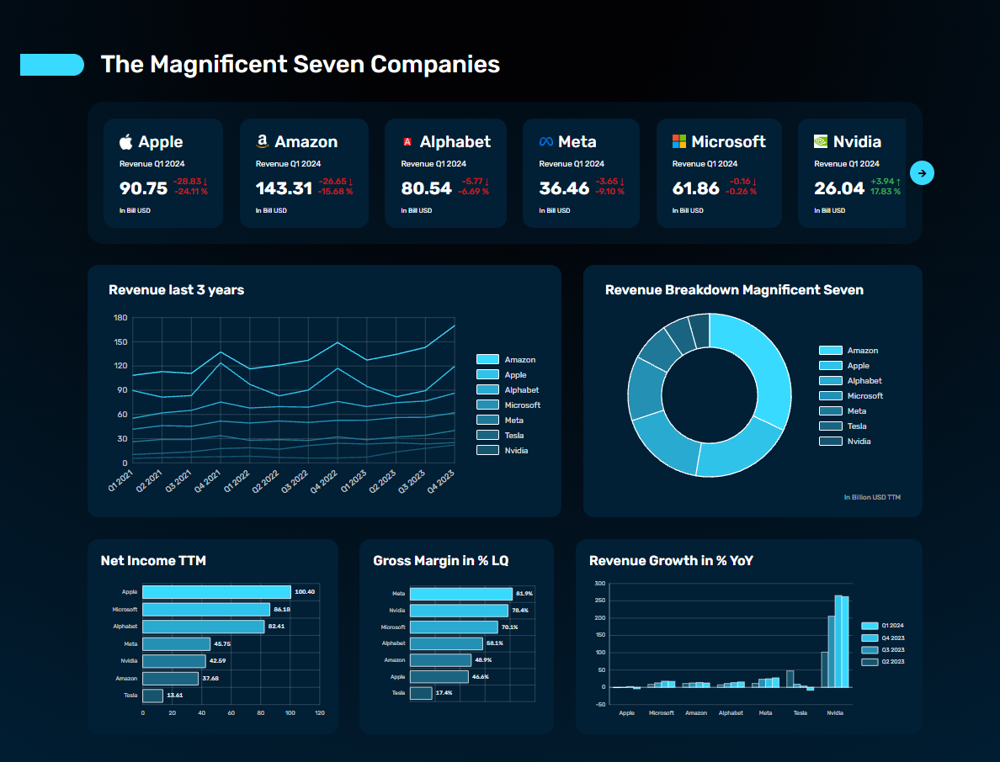

# The Magnificent Seven Companies – Stock Dashboard

A responsive financial dashboard for the "Magnificent Seven" tech companies (Apple, Amazon, Alphabet, Meta, Microsoft, Nvidia, Tesla). It visualizes revenue, net income, gross margin and year-over-year growth from quarterly report data.

All charts are hand-built **SVG components** – no charting library is used.



## Features

- **Current revenue carousel** – latest reported quarterly revenue per company in billion USD, including the absolute and relative change compared to the previous quarter.
- **Revenue last 3 years** – multi-line chart (Q1 2021 – Q4 2023) with a tooltip showing the values of all seven companies for the quarter closest to the pointer.
- **Revenue breakdown** – donut chart of the trailing twelve months (TTM) revenue. The tooltip shows the TTM value, the latest quarter and the share.
- **Net income TTM** – horizontal bar chart comparing the TTM net income of all companies.
- **Gross margin in % (last quarter)** – horizontal bar chart of the last reported gross margin. The tooltip shows the quarter the value comes from.
- **Revenue growth in % YoY** – grouped bar chart with the year-over-year growth of the last four quarters per company, including negative growth.
- **Responsive layout** – from desktop down to phones, with touch support for tooltips.

## Tech Stack

- [Vue 3](https://vuejs.org/) (Composition API, `<script setup>`)
- [TypeScript](https://www.typescriptlang.org/)
- [Vite](https://vite.dev/)
- [Vue Router](https://router.vuejs.org/) and [Pinia](https://pinia.vuejs.org/)
- [Prettier](https://prettier.io/) for formatting

## Getting Started

### Prerequisites

- Node.js `^22.18.0` or `>=24.12.0`

### Installation

```sh
git clone <repository-url>
cd stock-dashboard
npm install
```

### Available Scripts

| Command              | Description                          |
| -------------------- | ------------------------------------ |
| `npm run dev`        | Start the dev server with hot reload |
| `npm run build`      | Type-check and build for production  |
| `npm run preview`    | Preview the production build locally |
| `npm run type-check` | Run `vue-tsc` only                   |
| `npm run format`     | Format `src/` with Prettier          |

## Project Structure

```
src/
├── assets/
│   ├── data/stock.json          # Quarterly data for all companies
│   ├── fonts/                   # Local font files
│   └── icon/                    # Company logos and header icon
├── components/
│   ├── layout/                  # Header, BaseCard
│   └── stocks/                  # RevenueCard, RevenueChart, RevenueBreakdown,
│                                # NetIncomeChart, GrossMarginChart, RevenueGrowthChart
├── composables/
│   └── useElementWidth.ts       # Tracks an element's width via ResizeObserver
├── interface/
│   └── interface.ts             # Company type
├── router/                      # Vue Router setup
├── utils/
│   └── stock.ts                 # TTM, ranking, colors and axis scale helpers
└── views/
    └── DashboardView.vue        # Dashboard layout
```

## Data

The dashboard reads its numbers from `src/assets/data/stock.json`:

- `quarters` – the reported quarters from Q1 2021 to Q1 2024
- `companies` – one entry per company with `revenue` and `netIncome` (in billion USD) and `grossMargin` (in %) per quarter, plus metadata such as ticker, sector and logo

Derived values are calculated in the components and in `src/utils/stock.ts`:

- **TTM** – sum of the last four quarters
- **Revenue change** – latest quarter compared to the previous one
- **YoY growth** – quarter compared to the same quarter of the previous year

## How the Charts Stay Responsive

The SVG charts do not just scale down with their `viewBox`, because the text would become tiny on small screens. Instead, the `useElementWidth` composable measures the container width with a `ResizeObserver` and the charts calculate their geometry from it (1 viewBox unit = 1 px). This keeps fonts readable on every screen size, and elements adapt where needed:

- legends move below the plot on narrow containers
- axis labels are thinned out or shortened (e.g. tickers instead of company names)
- chart rows stack vertically on tablets and phones

Tooltips use pointer events, so they work with mouse and touch.

## Author

Patricia Linne

> **Note:** The UI/UX design and the concept for this project were provided by the **Developer Akademie**. The technical implementation, architecture, and the creation of the custom SVG diagrams were carried out independently.
